# PRISM

**PRISM** is a self-hosted help desk and project management system for IT teams
and managed service providers. One place for tickets, projects, customers,
assets and time, with a client portal for the people you support and an agent
for their computers.

## Screenshots

| | |
|---|---|
| 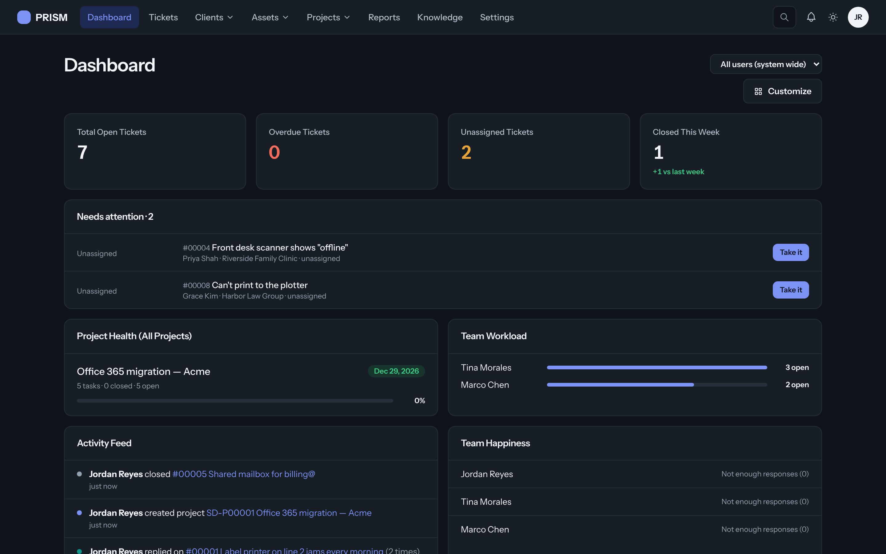 **Dashboard**: open work, what needs attention, project health, team workload and activity. | 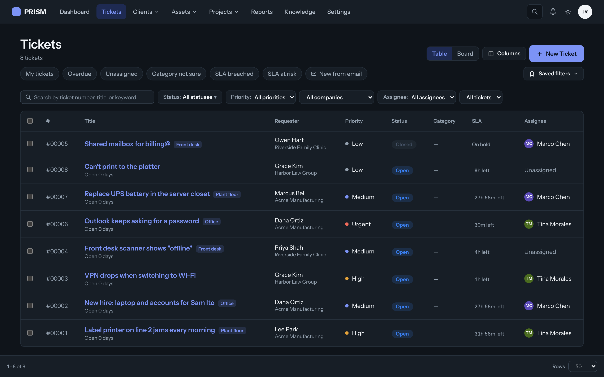 **Tickets**: filters, saved views, live SLA countdowns, table or board. |
| 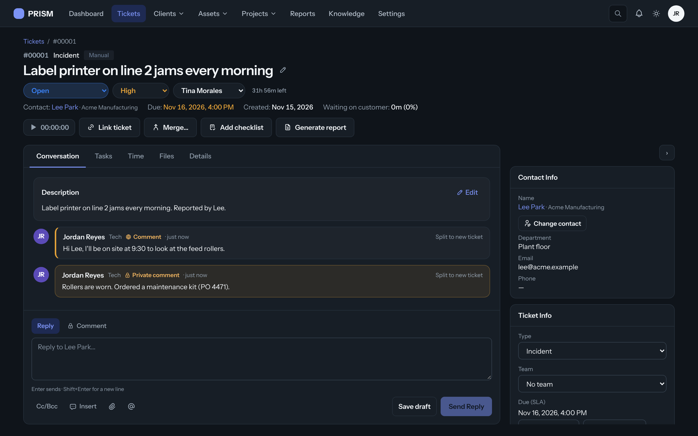 **A ticket**: replies and private comments, SLA clocks, timer, tasks, checklists, files. | 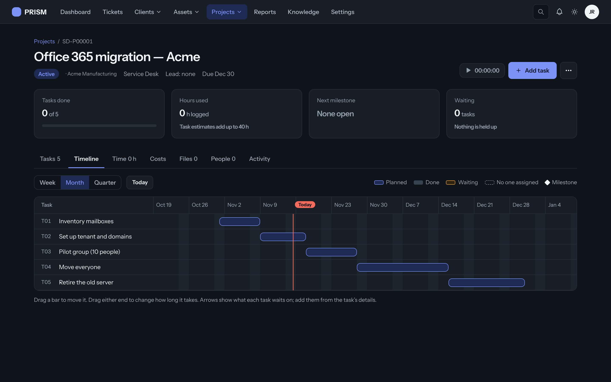 **Projects**: phases, tasks, dependencies and a drag-to-plan timeline. |
| 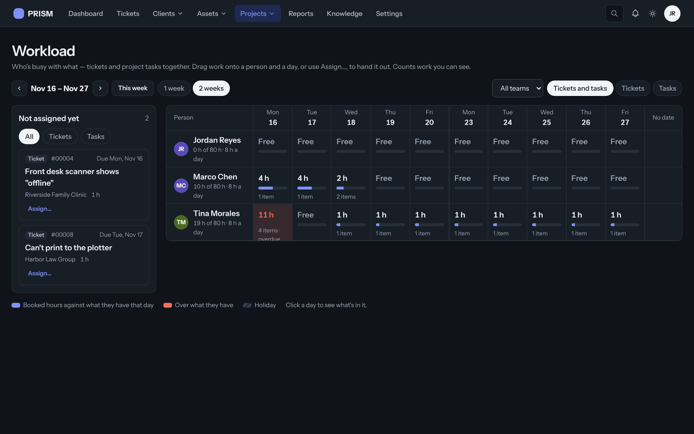 **Workload**: tickets and project tasks per person per day; drag to hand work out. | 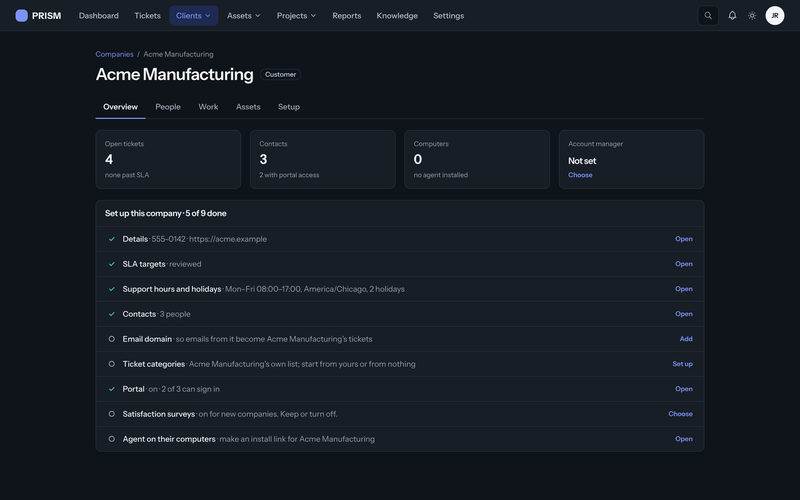 **Companies**: each customer's one page, with a setup list for new ones. |
| 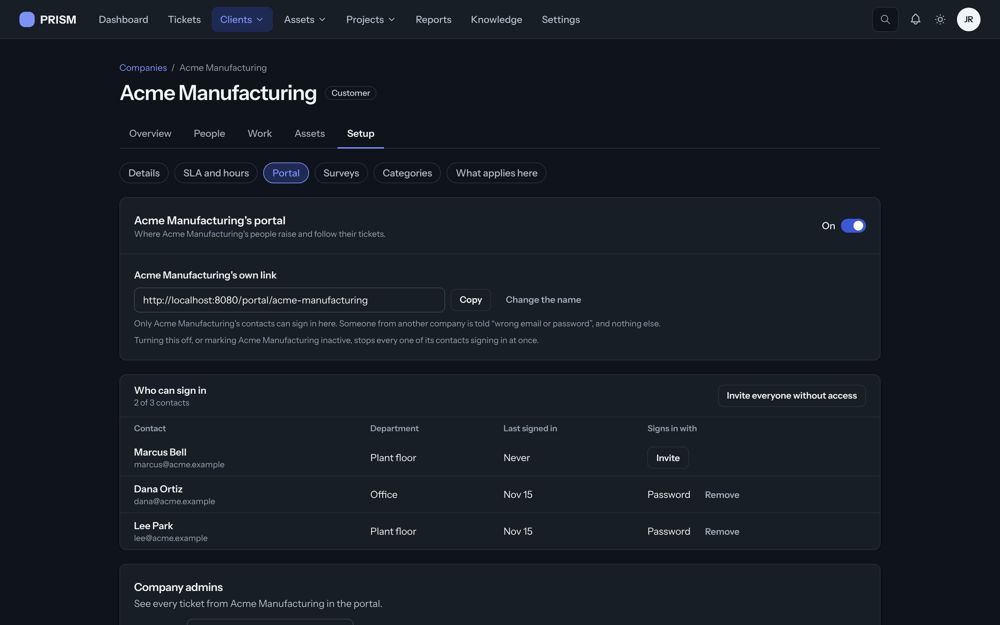 **Each company's portal**: its own link, who can sign in, invites, admins, Microsoft 365. | 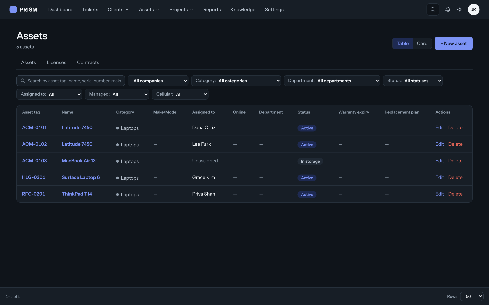 **Assets**: equipment, licenses and contracts, kept current by the PRISM agent. |
| 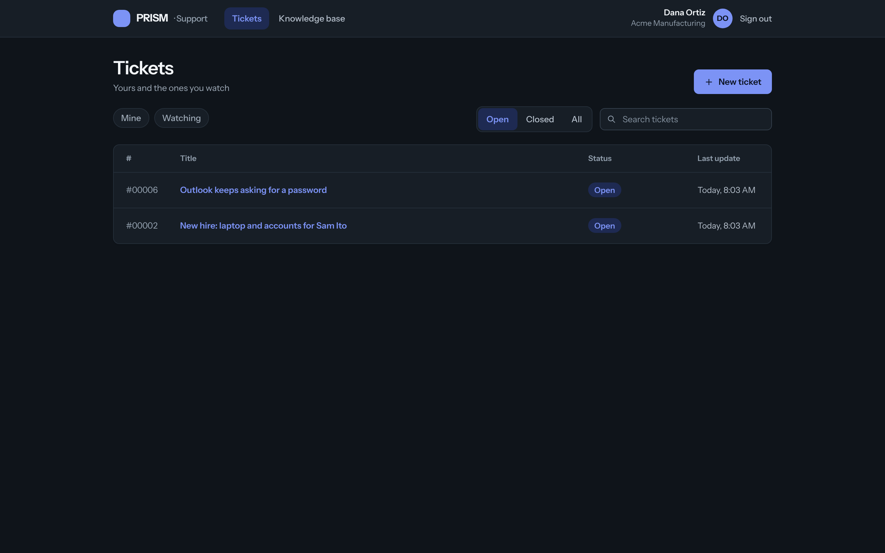 **Client portal**: customers raise and follow their tickets. | 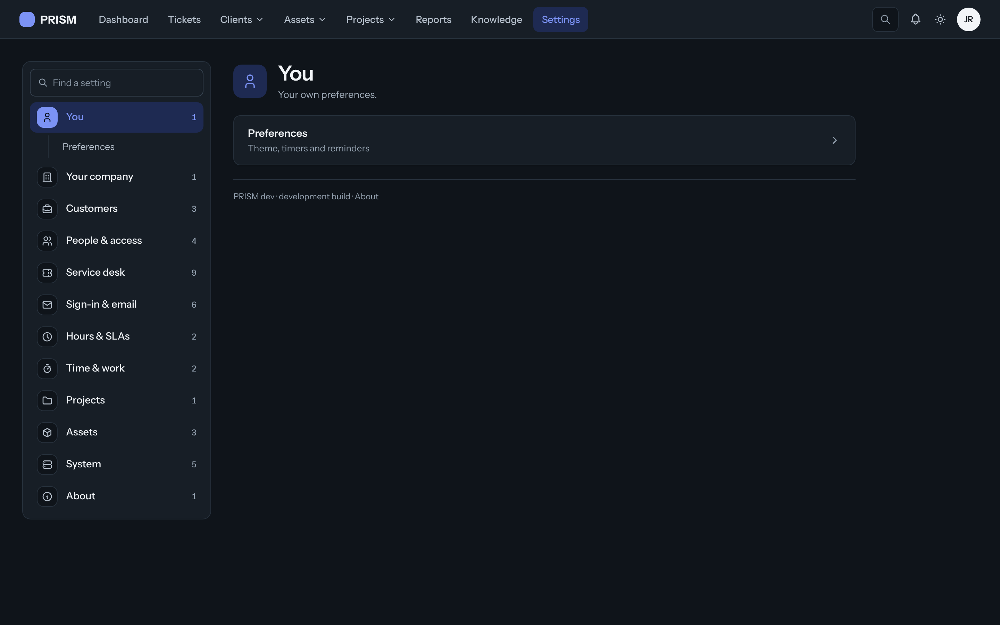 **Settings**: everything that applies to the whole help desk, in one place. |

<p align="center">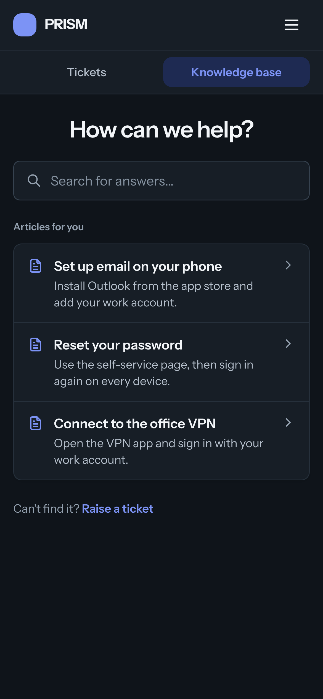</p>
<p align="center"><em>The portal and the whole app work on a phone.</em></p>

---

## What it does

- **Service desk.** Tickets from the web, email and the agent's tray app;
  queues, saved filters, a board view, canned responses, merge and split, bulk
  actions, CC/BCC, signatures, editable email templates, recurring tickets,
  ticket templates, categories per company, custom fields and workflow rules.
- **SLAs.** Assignment, first-response and resolution clocks per ticket type
  and priority, counted in each company's own support hours, time zone and
  holidays, with warnings, breaches, escalation rules and a compliance report.
- **Checklists and bundles.** Step-by-step checklists on tickets (with secure
  fields and steps that only show when they apply), and bundles that add
  several at once, suggested by category.
- **Projects.** Phases, milestones, tasks and subtasks with dependencies, a
  timeline you plan by dragging, templates, hour budgets, costs and files.
- **Time.** One timer and one time ledger across tickets, projects, tasks and
  subtasks, with reports and CSV export.
- **Workload.** Who is busy with what, day by day, across tickets and project
  tasks, against each person's own working hours.
- **Companies and contacts.** Your company and each customer have one page
  with everything for that company: contacts, departments, sites, SLA and
  hours, portal, surveys, categories, devices, and what applies to it.
- **Client portal.** Each company has its own portal link. Its contacts sign
  in (password or Microsoft 365), raise and follow tickets, and read the
  knowledge base; company and department admins see more. Nobody can sign in
  at another company's portal.
- **Assets.** Equipment, licenses and contracts, check-out forms with
  signatures, expiry alerts and MDM records.
- **The PRISM agent** (in testing) for Windows, macOS and Linux: keeps each
  computer's hardware, software and users current as an Asset, and gives
  people **Submit a ticket** in the tray or menu bar.
- **Knowledge base** for staff and, per audience, the portal.
- **Satisfaction surveys** per company, with scores on the dashboard, in
  reports and per technician.
- **Sign-in** with local accounts, Active Directory / LDAP, or single sign-on
  (OpenID Connect and SAML 2.0), with roles and fine-grained permissions.
- **Reports, audit log, imports and exports, an API with API keys, light and
  dark themes, and a layout that works on a phone.**

What's built and what's next: [`docs/ROADMAP.md`](docs/ROADMAP.md).

---

## Architecture

```
┌────────────┐      /api      ┌────────────┐      SQL      ┌────────────┐
│  frontend  │ ─────────────▶ │  backend   │ ────────────▶ │  mariadb   │
│  (nginx +  │   (proxied)    │  (Express) │               │  10.11     │
│   React)   │ ◀───────────── │            │ ◀──────────── │            │
└────────────┘                └────────────┘               └────────────┘
                                 │      ▲
                       writes    ▼      │ HTTPS (check-ins, tickets)
                         /uploads volume     PRISM agent on computers
```

- **Frontend:** React (Vite), React Router, Tailwind CSS, served by nginx,
  which also proxies `/api` to the backend.
- **Backend:** Node.js and Express, with Sequelize on **MariaDB**. Sessions are
  stored in the database; attachments go to the `uploads` volume and are
  checked by ClamAV.
- **Agent:** Go, installed as a system service with a per-user tray app
  (MSI, .pkg, .deb/.rpm/pacman), in [`agent/`](agent/).
- **Deployment:** Docker Compose, from images published to GitHub Container
  Registry.

---

## Roles and permissions

Access is governed by **granular permissions** grouped into roles. A user's
effective permissions are the union of the roles they hold, plus any per-user
overrides. Most permissions come in `own` / `department` / `all` tiers, and a
user can be limited to some companies.

| Seeded role | Intended for |
|------|--------------|
| **System Administrator** | Full access to everything. Cannot be deleted. |
| **System Technician** | Handles tickets and projects across the whole organization |
| **Department Manager** | Manages tickets, projects and people within one department |
| **Department Staff** | Works tickets within one department |
| **Read Only** | Views tickets, projects and people; no write access |

Roles are edited, and new ones added, under **Settings › People & access ›
Roles & permissions**. The people you support are **Contacts**, not users;
they sign in to their company's portal, never to PRISM itself.

> Directory (AD) and single sign-on users are created on first sign-in **with
> no permissions** until an administrator assigns a role (or an SSO group
> mapping does).

---

## Quick start

Requirements: Docker + Docker Compose, and a host with 3-4 GB of RAM (the ClamAV
virus scanner that checks every attachment uses about 1.2 GB, 2.4 GB while it
reloads its signatures each day).

```bash
git clone https://github.com/Stevy2191/PRISM.git
cd PRISM
./setup.sh
```

(For a test instance on the dev branch's images: `git clone -b dev …` and
`IMAGE_TAG=dev ./setup.sh`.)

`setup.sh` handles everything:

1. Checks that Docker and Docker Compose are installed.
2. Asks for your admin username and password (auto-generates a strong one if you press Enter).
3. Asks what host port to serve PRISM on (default **8080** — change it if 8080 is in use).
4. Asks whether you use Active Directory / LDAP — completely optional, safe to skip.
5. Generates secure random values for all database credentials and the session secret.
6. Writes the `.env` file automatically.
7. Asks how people will reach PRISM: through **your own HTTPS reverse proxy**
   (you give its address, e.g. `https://helpdesk.example.com`), **HTTPS with a
   test certificate** (see below), or **plain HTTP** on your network (a quick
   look only: the agent needs HTTPS). This sets `PUBLIC_APP_URL`, the address
   used in emailed links, single sign-on and the agent's portal link, and
   `COOKIE_SECURE`. A re-run asks again only if `.env` has no address yet.
8. Pulls the latest images from GitHub Container Registry.
9. Starts all containers (`docker compose up -d`).
10. Waits for the app to pass its health check.
11. Prints a summary: URL, login tab, username, and password.

The app is served on **`http://localhost:<APP_PORT>`** (default `http://localhost:8080`).
On first start the backend waits for MariaDB and applies all migrations automatically.

> **GHCR access:** images are published to `ghcr.io/stevy2191/prism-backend` and
> `…/prism-frontend`. If they're private, run `docker login ghcr.io` first (Personal
> Access Token with `read:packages` scope), or mark the packages public in GitHub.

### HTTPS with a test certificate (testing only)

The PRISM agent only connects over HTTPS (or plain HTTP on the PRISM machine
itself), and secure cookies need it too. To try them on a local network without
a real certificate, choose **HTTPS with a test certificate** when `setup.sh`
asks how people will reach PRISM. It asks for an HTTPS port (default **8443**) and the address(es)
other computers will use, such as `192.168.1.50` or `prism.lan`, then:

- makes a small certificate authority of its own in `.prism-test-ca/` (keep it
  private; it never goes into a container), limited to signing those addresses
  only, and a server certificate for them in `certs/` (renewed by re-running
  `setup.sh` when it nears expiry; it lasts 825 days);
- sets `COMPOSE_FILE=docker-compose.yml:docker-compose.tls.yml`, `HTTPS_PORT`,
  `TEST_CERT_NAMES`, `COOKIE_SECURE=true` and `PUBLIC_APP_URL` in `.env`. Plain
  HTTP on `APP_PORT` then redirects to HTTPS.

Each test computer must trust the test authority once. Download it from
`https://<address>:<port>/prism-test-ca.crt` (the Devices tab links to it and
shows the command), or copy `certs/prism-test-ca.crt`:

```bash
# macOS
sudo security add-trusted-cert -d -r trustRoot -k /Library/Keychains/System.keychain prism-test-ca.crt
# Windows (as administrator)
certutil -addstore -f Root prism-test-ca.crt
# Ubuntu
sudo cp prism-test-ca.crt /usr/local/share/ca-certificates/ && sudo update-ca-certificates
# Fedora, Arch
sudo trust anchor --store prism-test-ca.crt
```

Changing the addresses makes a new authority, which computers must trust again.
Microsoft 365 sign-in still needs a real certificate. For production, put PRISM
behind a reverse proxy with a real certificate instead (see
[Image publishing & production notes](#image-publishing--production-notes)). To
go back to plain HTTP, delete the `COMPOSE_FILE` line from `.env`, set
`COOKIE_SECURE=false`, remove `PUBLIC_APP_URL`, and run `docker compose up -d`.

### First login

Sign in at the URL printed by `setup.sh` on the **Local Account** tab, using the
username and password shown at the end of the script. Go to **Settings › People &
access › Users** to give your directory account a role or create more local accounts. You can delete
the bootstrap account once other admins exist.

**Sign-in goes straight back to the login page?** The browser isn't keeping the
session cookie. With `COOKIE_SECURE=true` the cookie is only issued on a request
PRISM knows was HTTPS: open PRISM at its `https://` address. Behind a proxy that
handles HTTPS (Nginx Proxy Manager, Caddy, a load balancer), that proxy must send
`X-Forwarded-Proto: https`; they do by default, and PRISM's nginx passes it on.
Sign-in says so when the cookie can't be set, and the backend log names the
setting.

### Changing the host port

`APP_PORT` in `.env` controls which port on your host the app listens on.
To move PRISM to a different port after initial setup:

```bash
# Edit .env and change APP_PORT, then restart:
docker compose up -d
```

### Updating to the latest images

```bash
docker compose pull && docker compose up -d
```

By default a stack tracks `latest`, which follows released code. To run an exact
version instead — to pin a deployment, or to roll back after a bad upgrade — set
`IMAGE_TAG` in `.env` and pull again:

```bash
IMAGE_TAG=0.1.0
```

The running version is shown in **Settings › About**. See
[RELEASING.md](RELEASING.md) for how versions are built, deployed and rolled
back, and [UPGRADING.md](UPGRADING.md) for what changed between them.

### Manual setup (advanced)

If you prefer to configure things yourself instead of running `setup.sh`:

```bash
cp .env.example .env
# Edit .env and set, at minimum:
#   SESSION_SECRET           openssl rand -hex 32   (required)
#   ENCRYPTION_KEY           openssl rand -hex 32   (recommended)
#   DB_PASSWORD              a real password
#   BOOTSTRAP_LOCAL_PASSWORD the first admin's password
#   APP_PORT                 host port, default 8080
#   LDAP_*                   only if you use Active Directory
docker compose pull
docker compose up -d
```

PRISM **refuses to start** if `SESSION_SECRET` is missing, left as a
placeholder, or shorter than 32 characters — it signs session cookies and
derives the key that encrypts stored credentials. The same applies to
placeholder values left in `DB_PASSWORD` or `BOOTSTRAP_LOCAL_PASSWORD`.
Startup lists every problem it finds at once. See [UPGRADING.md](UPGRADING.md)
if you are upgrading an existing install.

### Building from source (development)

```bash
cp .env.example .env
docker compose -f docker-compose.dev.yml up -d --build
```

The dev stack exposes the frontend on `http://localhost:<APP_PORT>` (default 3000),
the backend on `http://localhost:3001`, and MariaDB on port `3306` for direct access.

---

## Uninstalling

To completely remove PRISM — all containers, database data, uploaded attachments,
Docker volumes, pulled images, and the `.env` file:

```bash
./uninstall.sh
```

The script will print a clear warning and ask you to type `yes` before doing
anything. Once done, delete the directory:

```bash
rm -rf /path/to/PRISM
```

---

## Database migrations

Schema is managed with **Sequelize migrations** — never with `sync({ force: true })`.

**Migrations run automatically** every time the backend container starts (see
`backend/docker-entrypoint.sh`), so the normal `docker compose up -d` flow needs no
manual migration step. New migrations are applied on the next restart.

If you ever need to run them by hand:

```bash
# Apply all pending migrations
docker compose exec backend npm run migrate

# Roll back the most recent migration
docker compose exec backend npm run migrate:undo
```

> **Writing a migration?** `queryInterface.showAllTables()` returns
> `{ tableName, schema }` objects, not strings, so a guard like
> `tables.includes('MyTable')` is always false. Normalize it first:
> `(await queryInterface.showAllTables()).map((t) => (typeof t === 'string' ? t : t.tableName))`.
> The existing migrations all do this.

Running locally without Docker (from `backend/`):

```bash
npm install
npm run migrate
npm start
```

The Express session table (`Sessions`) is created automatically at startup by
`connect-session-sequelize`; all application tables come from the migrations in
`backend/migrations/`.

---

## Authentication

Staff sign in with any of:

- **Local account**: username or email and password (bcrypt). Created under
  **Settings › People & access › Users**; a new account changes its password
  at first sign-in (the first admin made by `setup.sh` is exempt).
- **Active Directory / LDAP**: verified against your directory; display name
  and email are synced at each sign-in. See [below](#configuring-ldap--active-directory).
- **Single sign-on**: OpenID Connect or SAML 2.0 against your own identity
  provider. See [below](#single-sign-on-sso).

Sessions are stored in MariaDB. Scripts and tools use an API key instead
([below](#api-keys-and-the-api)). Contacts sign in to their company's portal
with a password from an invite link, or with Microsoft 365.

---

## Single sign-on (SSO)

PRISM federates with any identity provider speaking **OpenID Connect** or
**SAML 2.0**, and can use several at once. Configure them under
**Settings › Sign-in & email › Single sign-on** (requires `settings.manage_system`).

### Adding a provider

1. **Settings › Sign-in & email › Single sign-on › Add provider**, pick the protocol and give it
   a slug (it appears in the callback URL and cannot be changed later).
2. Save, then copy the **Redirect URI** / **ACS URL** shown on the provider and
   register it with your IdP. SAML providers also expose service-provider
   metadata for upload.
3. For OIDC, supply the issuer URL and client ID/secret — PRISM reads
   `/.well-known/openid-configuration`, so the endpoints are discovered.
   For SAML, supply the sign-on URL and the IdP's signing certificate.
4. Enable the provider. A button appears on the login page.

> Callback URLs are built from `PUBLIC_APP_URL`. Set it, or the URLs PRISM
> shows (and sends to the IdP) will point at localhost.

### How accounts are matched

Users are matched on the provider's **stable subject identifier** (OIDC `sub`,
SAML `NameID`) — never on email address, which an IdP may assert without
verifying and which can be recycled between people.

A subject signing in for the first time gets an account created automatically,
**with no permissions**, unless a group mapping applies. Turn off *Create
accounts automatically* to require that an administrator link the account
first.

### Mapping groups to roles

Under a provider's **Group mappings**, map a group claim value to a PRISM role.
Mappings are re-evaluated on every sign-in, so removing someone from a group in
your IdP removes the role here the next time they log in. Roles an
administrator assigned by hand are left alone.

For OIDC, set the *Groups claim* to whatever your IdP emits (`groups` for Entra
ID and Okta). For SAML, set the *Groups attribute*.

### Requiring SSO

**Require single sign-on** disables password and directory login for everyone
except **break-glass accounts** — local accounts marked on their user page as
able to sign in with a password regardless.

PRISM refuses to turn this on unless at least one enabled provider and one
active local break-glass account exist, and refuses to remove the last
break-glass account while it is on. Without that, an identity provider outage
or misconfiguration would lock you out of your own helpdesk with no way back
in.

### Not supported

IdP-initiated login (SP-initiated only), Single Logout (SLO), and SCIM
provisioning.

---

## Configuring LDAP / Active Directory

LDAP is **optional**. If you don't use Active Directory, skip it during `setup.sh`
and only the Local Account login tab will be available. To enable it later, edit the
`LDAP_*` variables in `.env` and restart (`docker compose up -d`).

LDAP settings are read from environment variables:

| Variable | Description | Example |
|----------|-------------|---------|
| `LDAP_URL` | Domain controller URL | `ldap://dc01.domain.local` (or `ldaps://…:636`) |
| `LDAP_BASE_DN` | Search base | `DC=domain,DC=local` |
| `LDAP_BIND_DN` | Service account DN used to search the directory | `CN=svc-prism,OU=Service Accounts,DC=domain,DC=local` |
| `LDAP_BIND_PASSWORD` | Service account password | — |
| `LDAP_USER_FILTER` | Filter to find the user; `{{username}}` is substituted | `(sAMAccountName={{username}})` |

**Login flow:** the backend binds with the service account, searches for the user
with `LDAP_USER_FILTER`, then re-binds as that user's DN with the supplied password
to verify the credentials. On success it syncs the user's `displayName`, `mail`,
and `sAMAccountName` into the database.

You can review the effective (non-secret) LDAP configuration, and sync contacts
from the directory, under **Settings › Sign-in & email › Directory**.

---

## Image publishing & production notes

GitHub Actions runs the tests, then builds and publishes both images to GHCR on
every push to `main` and `dev` and on every version tag:

- `ghcr.io/stevy2191/prism-backend` and `ghcr.io/stevy2191/prism-frontend`
- tagged `latest` (from `main`), `dev` (from `dev`), the version (e.g. `0.4.0`)
  and the git SHA

The host port is `APP_PORT` in `.env` (default **8080**). For production, put a
reverse proxy with a real certificate in front, set `PUBLIC_APP_URL` to its
`https://` address and keep `COOKIE_SECURE=true`; the proxy must send
`X-Forwarded-Proto: https`.

### Pulling the images

`docker compose up -d` (and `docker compose pull`) fetch these images automatically,
so you normally don't pull by hand. Image names must be **lowercase**
(`ghcr.io/stevy2191/…`).

**If the packages are public** — no authentication is needed. Any host can pull
directly:

```bash
docker pull ghcr.io/stevy2191/prism-backend:latest
docker pull ghcr.io/stevy2191/prism-frontend:latest
```

To make them public: GitHub → your profile → **Packages** → select the package →
**Package settings** → **Danger Zone** → **Change visibility** → **Public**.

**If the packages are private** (the default) — log in to GHCR on each host first
with a Personal Access Token that has the `read:packages` scope:

```bash
echo "$GHCR_TOKEN" | docker login ghcr.io -u stevy2191 --password-stdin
docker compose pull
```

---

## API keys and the API

Scripts and tools authenticate with an `X-API-Key` header instead of a session
cookie. Create a key under **Settings › People & access › API keys**; it is
shown **once** and stored hashed. Revoke it from the same page.

```bash
curl -H "X-API-Key: prism_xxxxxxxx..." https://your-host/api/v1/tickets
```

The API lives under `/api/v1` and is the one the web app uses: tickets,
comments, attachments, time, projects and tasks, companies, contacts, assets,
knowledge base, reports and settings. Responses are JSON; errors look like:

```json
{ "error": true, "message": "Ticket not found", "code": "NOT_FOUND" }
```

A key acts with its owner's permissions.

---

## Roadmap, design notes and release notes

- [`docs/ROADMAP.md`](docs/ROADMAP.md): what's built, what's next, and notes for
  working on the code.
- `docs/superpowers/specs/` and `docs/superpowers/plans/`: each feature's design
  and step-by-step plan; `docs/mockups/`: the approved screen designs.
- [`UPGRADING.md`](UPGRADING.md): what changed in each version.
- [`RELEASING.md`](RELEASING.md): how versions are built, deployed and rolled back.

## Running the tests

The backend has a Jest + supertest suite covering authentication, the
authorization model, single sign-on, and a regression test for each fixed
security finding. CI runs it before publishing images, so a failure blocks the
release.

**Node 24.9 or newer is required** — several dependencies are ESM-only, and
Jest can only `require()` an ES module natively from that version. The
Dockerfiles and CI both pin Node 24; the suite fails fast with an explanation
on anything older.

```bash
cd backend
nvm use 24                  # or any Node >= 24.9
npm ci
cp .env.example .env.test   # set DB_* to a scratch database and a SESSION_SECRET
npm run test:migrate        # applies migrations to <DB_NAME>_test
npm test                    # or: npm run test:unit / npm run test:integration
```

Integration tests run against a real MariaDB schema and drive the real Express
app — the authorization stack is deliberately not mocked, since it is the
thing under test. The SSO tests run against a mock identity provider that
speaks both OIDC and SAML, signing real tokens and assertions, so signature
and replay failures are exercised rather than assumed.

---

## Project layout

```
prism/
├── docker-compose.yml          # run from the published images
├── docker-compose.tls.yml      # adds HTTPS with a test certificate
├── docker-compose.dev.yml      # build everything from source
├── setup.sh                    # interactive setup (run this first)
├── uninstall.sh                # remove containers, volumes, images and .env
├── .env.example
├── backend/                    # Express API, Sequelize models and migrations, tests
├── frontend/                   # React app (staff app and client portal), nginx config
├── agent/                      # the PRISM agent (Go) and its installers
├── docs/                       # roadmap, specs, plans, mockups, screenshots
└── .github/workflows/          # tests, image publishing, agent builds
```

---

## Operational notes

- **Attachments** are limited to 25 MB, scanned by ClamAV, and stored on the
  `uploads_data` volume.
- **Audit log:** every change writes who did what to what; see **Settings ›
  System › Audit log**.
- **Sessions** are stored in MariaDB and survive restarts.
- **Backups:** back up the MariaDB database and the `uploads_data` volume.

## License

PRISM is licensed under the [GNU Affero General Public License v3.0](LICENSE)
(`AGPL-3.0-only`). Versions up to and including v0.2.0 were released under
the MIT License and remain available under it.
